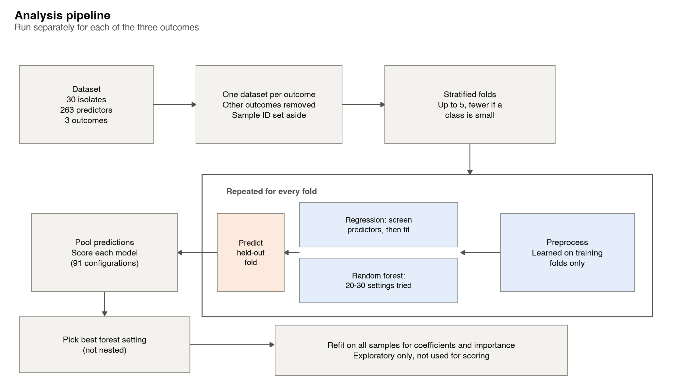
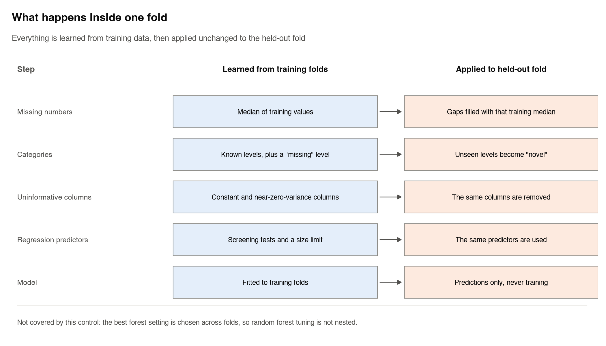
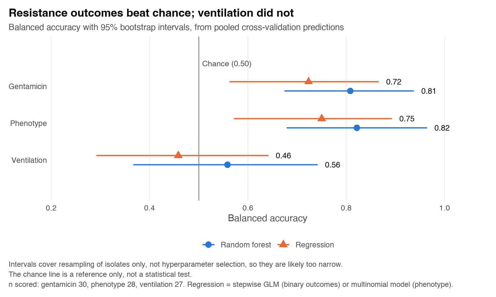
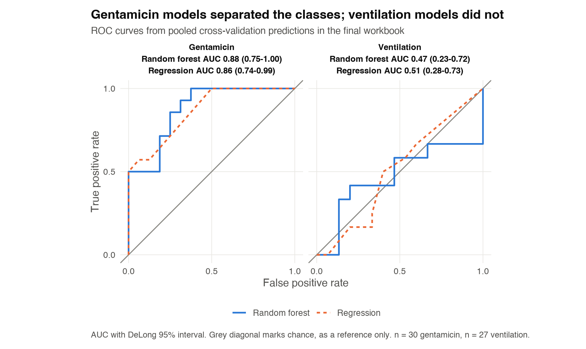

# Predicting Antibiotic Resistance and Disease Severity in *Klebsiella*

R code from my dissertation at the University of Greenwich (2026). It tests whether genomic and phenotypic data from 30 ICU-derived *Klebsiella* isolates can predict three clinical-risk outcomes: mechanical ventilation, gentamicin resistance and resistance phenotype (MDR, XDR or PDR). Resistant *Klebsiella* infections are hard to treat, so earlier warning signs could help.

## Method

- **Models:** logistic regression, multinomial regression and random forest.
- **Validation:** stratified cross-validation, with up to 5 folds.
- **Leakage control:** imputation, filtering and feature screening are fitted on training folds only, and the other outcomes are removed from each analysis.
- **Comparison:** 91 model configurations.





## Key result and limitations

| Outcome | Best model | Balanced accuracy |
|---|---|---|
| Gentamicin resistance | Random forest | 0.81 |
| Resistance phenotype | Random forest | 0.82 |
| Mechanical ventilation | Random forest | 0.56 (near chance, rejected) |





Full metrics and a dataset summary are in [results/summary_tables.md](results/summary_tables.md). Individual confusion matrix cell counts are left out to protect privacy, because group sizes are small.

These are internal cross-validation results from my dissertation on a small sample (n = 30), with no separate test set, so the work is exploratory. Antibiotic test results were among the predictors, which may inflate the resistance scores, and tuning was not nested. Results can vary slightly with package versions.

## What I'd do differently

This was my first machine learning project. Reviewing it later, I would:

- use nested cross-validation for tuning
- exclude antibiotic test results when predicting resistance phenotype, because they help define it
- keep one script as the single source for all results and figures

## Data

Data not included (clinical data; not shareable).

The dataset has one row per isolate: 30 rows and 267 columns (a sample ID, 3 outcomes and 263 predictors). Predictors cover sequence and antigen types, resistance and virulence genes, disinfectant and heavy-metal genes, mutations, plasmids, antibiotic test results and biofilm.

## Running it

The pipeline needs the private data, so it won't run from this repo alone. With access, save the workbook as `data/analysis_data.xlsx`, with a sheet called `original_data`. Then, from the project root:

```bash
Rscript -e 'renv::restore()'
```

```bash
Rscript scripts/run_all.R
```

The tests use small made-up data and run without the private file:

```bash
Rscript -e 'testthat::test_dir("tests/testthat")'
```

Package versions are locked with `renv`, and they may differ from those used for the dissertation.

## Honesty note

I designed the analysis and ran and interpreted all models. Parts of the code were written with AI assistance so I could focus on learning the methods. I reviewed and tested that code, and I am developing my skills by working through it.

## Licence

All rights reserved.
